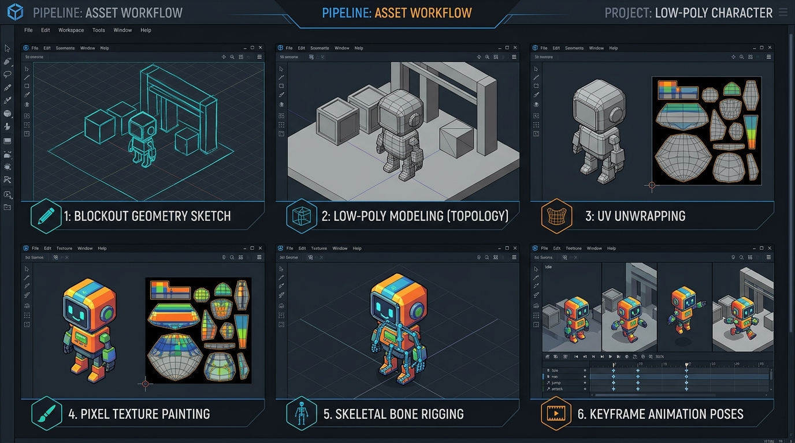
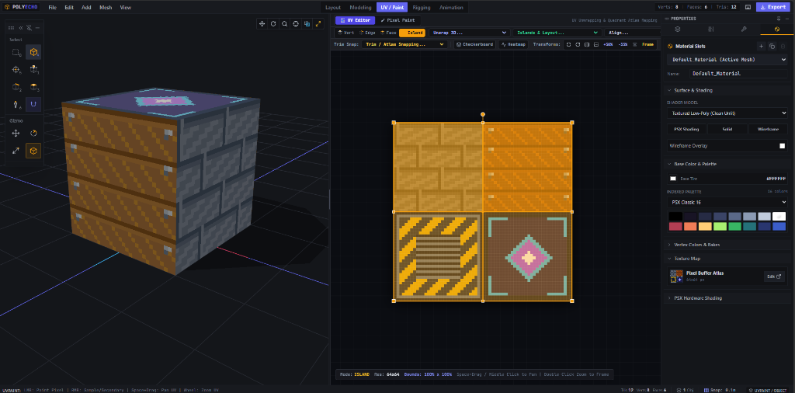

# PolyEcho — Official Software Manual

PolyEcho is a dedicated desktop 3D modeling, UV unwrapping, pixel texture painting, skeletal rigging, and keyframe animation suite. It is designed specifically for indie game developers, retro game creators (targeting PS1, Nintendo 64, Nintendo DS, and Dreamcast visual styles), and technical artists who want a fast, focused, low-overhead creation pipeline without the complexity of general-purpose DCC packages.



---

## Table of Contents

1. [System Overview & Philosophy](#1-system-overview--philosophy)
2. [Installation & Getting Started](#2-installation--getting-started)
3. [User Interface Overview](#3-user-interface-overview)
4. [Viewport Navigation & Camera Controls](#4-viewport-navigation--camera-controls)
5. [The Five Workspaces](#5-the-five-workspaces)
   - [5.1 Blockout Workspace](#51-blockout-workspace)
   - [5.2 Modeling Workspace](#52-modeling-workspace)
   - [5.3 UV / Paint Workspace](#53-uv--paint-workspace)
   - [5.4 Rigging Workspace](#54-rigging-workspace)
   - [5.5 Animation Workspace](#55-animation-workspace)
6. [Retro Shading & CRT Post-Processing](#6-retro-shading--crt-post-processing)
7. [Modifiers System](#7-modifiers-system)
8. [Import & Export Pipelines](#8-import--export-pipelines)
9. [Game Engine Handoff (Godot, Unity, Unreal)](#9-game-engine-handoff)
10. [Comprehensive Keyboard Shortcuts Reference](#10-comprehensive-keyboard-shortcuts-reference)
11. [Troubleshooting & Frequently Asked Questions](#11-troubleshooting--frequently-asked-questions)

---

## 1. System Overview & Philosophy

Modern 3D suites are often weighed down by tens of thousands of features tailored for cinematic visual effects, photorealistic raytracing, and multi-million-polygon sculpting. For indie developers making low-poly games, this adds friction.

PolyEcho takes the opposite approach:
- **Low-Poly First:** Built specifically for polygon counts ranging from 50 to 5,000 triangles per asset.
- **Unified Pipeline:** Seamlessly transition between volume drafting, polygon box modeling, 2D pixel painting, skeletal rigging, and timeline animation within a single application window.
- **Pixel-Accurate Texturing:** Integrated pixel canvas with 16x16 up to 256x256 texture support, retro color quantization palettes, Bayer 8x8 matrix dithering, and face tile stamping.
- **Zero-Friction Game Engine Export:** Exports single-file `.glb` assets with embedded bone armatures, animations, materials, textures, and timeline event markers that open immediately in Godot, Unity, and Unreal Engine.



---

## 2. Installation & Getting Started

### System Requirements
- **Operating Systems:** Windows 10/11 (64-bit), macOS 11+, Linux (Ubuntu 20.04+, Fedora 36+)
- **Graphics:** OpenGL 3.3+ / WebGL 2.0 compatible GPU
- **RAM:** Minimum 4 GB (8 GB recommended)
- **Disk Space:** 250 MB free drive space

### Running the Desktop Application
Download the installer or pre-packaged executable for your operating system:
- **Windows:** Run `PolyEcho Setup.exe` or launch `polyecho.exe`
- **macOS:** Drag `PolyEcho.app` into your Applications folder
- **Linux:** Make the `.AppImage` executable (`chmod +x PolyEcho*.AppImage`) and launch

### Running from Source
If building from repository source:
```bash
# Clone the repository
git clone https://github.com/CharmingBlaze/polyecho.git
cd polyecho

# Install package dependencies
npm install

# Launch Electron desktop development window
npm run dev

# Run in standard browser tab for layout verification
npm run dev:web

# Build production installers
npm run build
npm run dist
```

---

## 3. User Interface Overview

The interface consists of five primary functional regions:

```
+-------------------------------------------------------------------------------+
| 1. MASTER HEADER: Menus (File/Edit/Mesh/Help), Transform, Snap, Workspaces, Shading |
+---------+-------------------------------------------------------+-------------+
|         |                                                       |             |
| 2. LEFT | 3. CENTRAL 3D VIEWPORT                                | 4. RIGHT    |
| TOOLBAR |    (Active Geometry Canvas, Transform Gizmos,         | SIDEBAR     |
|         |     Grid, Dual-Pane UV/Paint Splitter)                | (Outliner,  |
| (Select,|                                                       |  Inspector, |
|  Move,  |                                                       |  Tools,     |
|  Draw,  |                                                       |  Modifiers, |
|  Extrude|                                                       |  Materials, |
|  Knife) |                                                       |  Textures)  |
|         |                                                       |             |
+---------+-------------------------------------------------------+-------------+
| 5. STATUS BAR & TIMELINE: Coordinates, Selection Counts, Tool Prompts, Dope Sheet   |
+-------------------------------------------------------------------------------+
```

### 1. Master Header
- **Application Menus:**
  - **File:** Create new project (`Ctrl+N`), Open `.psxproj` (`Ctrl+O`), Save project (`Ctrl+S`), Import (OBJ, GLTF/GLB, Blockbench, Textures), Export game assets, and Preferences (`Ctrl+,`).
  - **Edit:** Undo (`Ctrl+Z`), Redo (`Ctrl+Y`), Select All (`Ctrl+A`), Deselect (`Alt+A`), Invert Selection (`Ctrl+I`), Select Linked (`Ctrl+L`), Grow/Shrink selection, and Edge Boundary filters.
  - **Mesh:** Contextual modeling operations (Extrude, Inset, Bevel, Loop Cut, Knife, Subdivide, Merge, Bridge, Fill, Normals, Booleans, Straighten, Decimate).
  - **Help:** Direct access to documentation, workspace guides, keyboard shortcuts map, navigation instructions, and troubleshooting.
- **Transform Orientation & Pivot Selector:** Set coordinate space to Global, Local, Normal, or View. Set pivot center to Median, Active Element, or 3D Cursor.
- **Snapping Control:** Toggle grid snapping (`Shift+Tab`), set grid step resolution (0.1, 0.25, 0.5, 1.0), and enable vertex, edge midpoint, or face center snapping.
- **Live Symmetry:** Toggle real-time mirroring along X, Y, or Z axes.
- **Workspace Navigation:** Switch between Modeling, Blockout, UV / Paint, Rigging, and Animation.
- **Camera & Shading:** Camera perspective presets, Quad View (`Ctrl+Alt+Q`), Shading modes (Textured, Solid, Wireframe, Dreamcast), Overlays, X-Ray (`Alt+Z`), and CRT scanline filter.

### 2. Left Toolbar
Contains the primary modal tools for the active workspace: Selection, Move, Rotate, Scale, Extrude, Inset, Bevel, Knife, Loop Cut, and Bone manipulators.

### 3. Central 3D Viewport
WebGL-accelerated 3D editing space supporting real-time shadows, vertex snapping, custom polygon rendering, and interactive gizmos. In the UV / Paint workspace, this area splits into side-by-side 3D and 2D canvas panes.

### 4. Right Sidebar
Houses the hierarchical Outliner and tabbed Inspector:
- **Outliner:** Hierarchy list of meshes, armatures, bones, and reference planes with visibility and lock toggles.
- **Tools:** Context-sensitive options for the active tool (subdivision cuts, bevel offsets, extrusion depths, merge distance).
- **Properties:** Numerical Transform controls (Position, Rotation, Scale, Dimensions).
- **Modifiers:** Non-destructive modifier stack (Mirror, Subdivision Surface, Solidify).
- **Material:** Material slots, color tint, shading model, roughness, metalness, and alpha cutouts.
- **Texture:** Resolution settings, pixel buffers, layer management, and color palettes.

### 5. Status Bar
Displays vertex/edge/face counts, selected object info, active tool guidance prompts, and current grid snap status. In the Animation workspace, the Timeline sits directly above the status bar.

---

## 4. Viewport Navigation & Camera Controls

### Mouse Navigation

| Action | Input Chord | Description |
| :--- | :--- | :--- |
| **Orbit** | Middle Mouse Button (MMB) Drag *or* Alt + LMB Drag | Rotates camera around current pivot point |
| **Pan** | Shift + MMB Drag *or* Right Mouse Button (RMB) Drag | Shifts camera parallel to current view plane |
| **Zoom** | Mouse Scroll Wheel *or* Ctrl + MMB Drag | Smoothly dollys camera closer or further |
| **Focus Selection** | Period (`.`) on Numpad *or* `F` | Centers camera on selected vertices, edges, or objects |

### Camera Angle Presets

| View Preset | Shortcut | Description |
| :--- | :--- | :--- |
| **Front Orthographic** | `Numpad 1` | Orthographic view looking down the Y/Z plane |
| **Right Orthographic** | `Numpad 3` | Orthographic view looking down the X/Z plane |
| **Top Orthographic** | `Numpad 7` | Orthographic view looking down the X/Y plane |
| **Perspective / Iso Toggle** | `Numpad 0` | Toggles true isometric view angle |
| **Quad View** | `Ctrl + Alt + Q` | Splits screen into Top, Front, Right, and 3D Perspective |

### Transform Space & Pivot Points
- **Global:** Transformations follow world cardinal axes (X = East/West, Y = Up/Down, Z = North/South).
- **Local:** Transformations follow the selected object's individual orientation.
- **Normal:** Transformations align to the average surface normal vector of the selected faces or edges.
- **Median Pivot:** Rotations and scales center around the average center of all selected elements.
- **Active Element:** Transformations center around the last element selected.
- **3D Cursor:** Transformations center around the 3D cursor marker.

---

## 5. The Five Workspaces

PolyEcho organizes your asset pipeline into five dedicated workspaces accessible via the top center tabs:

```
[ BLOCKOUT ] -> [ MODEL ] -> [ UV / PAINT ] -> [ RIG ] -> [ ANIMATE ]
```

---

### 5.1 Blockout Workspace

The Blockout workspace allows you to sketch initial silhouettes, establish correct character proportions, and trace reference concept art before building clean geometry.

#### Loading Concept Art Reference Images
1. Open the **Refs** tab in the right sidebar.
2. Click **Add Reference Image** and load your PNG or JPG sketch.
3. Assign the reference plane to Front, Side, or Top projection.
4. Adjust position, scale, and opacity slider so your drawing aligns with the 3D grid.

#### Poly Draw (`F`)
- Click anywhere on the ground grid or reference plane to place consecutive boundary vertices.
- Click near your starting point to close the polygon loop and generate a planar face.
- Press `Enter` to commit or `Esc` to cancel.

#### Shape Draw
- Draw volume silhouettes, extrusion profiles, or cross-sectional ribbons.
- Preview the procedural 3D volume in real time.
- When satisfied with the form, click **Make Editable Mesh** to convert the procedural volume into standard polygons ready for the Modeling workspace.

---

### 5.2 Modeling Workspace

The Modeling workspace is where primary polygon topology, box modeling, and edge loop construction occur.

#### Selection Modes

| Key | Mode | Description |
| :--- | :--- | :--- |
| `1` | **Vertex Mode** | Select, move, and weld individual mesh points |
| `2` | **Edge Mode** | Select, slide, and bevel boundary edges |
| `3` | **Face Mode** | Select polygons for extrusion, insetting, and shading |
| `4` | **Object Mode** | Transform entire mesh objects as individual scene entities |
| `5` | **Origin / Pivot Mode** | Re-position the local transformation pivot point of an object |
| `Tab` | **Toggle Edit / Object** | Fast toggle between Component editing and Object mode |

#### Box Selection (Marquee)
Press `B` or hold `Ctrl + LMB Drag` to drag a selection rectangle. When combined with X-Ray mode (`Alt+Z`), box selection captures occluded vertices on the back side of the model.

#### Modal CAD Operators

- **Move (`G`), Rotate (`R`), Scale (`S`):**
  - Press the key, move your mouse to adjust, and left-click to commit (or right-click to cancel).
  - Constrain axis: Press `X`, `Y`, or `Z` immediately after pressing the transform key.
  - Planar constraint: Press `Shift+Z` to move only along the ground plane (X and Y), locking Z.
  - Precision numeric input: Type a number (e.g. `G`, `X`, `2.5`, `Enter`) to offset by exact units.

- **Extrude (`E`):**
  - Pulls new geometry outward from selected faces along their normal vector.
  - Press `Alt+E` to extrude individual faces separately rather than as a unified region.

- **Inset (`I`):**
  - Scales an inward duplicate border inside selected faces, creating edge loops for windows, panels, or joints.

- **Bevel (`Ctrl+B`):**
  - Chamfers sharp edges into angled facets. Set segment count in the Mesh Tools panel for rounded bevels.
  - Press `Ctrl+Shift+B` to bevel individual vertices into triangle corner facets.

- **Loop Cut and Slide (`Ctrl+R`):**
  - Hover over any quad face to preview an edge ring cut.
  - Left-click to place the cut, slide the loop along the edge ring to the desired position, and left-click again to commit.

- **Knife Topology Tool (`K`):**
  - Click across vertices and edges to slice custom cuts directly across polygons.
  - Snaps to edge midpoints and existing vertices. Press `Enter` to finalize the cut.

- **Subdivide (`W`):**
  - In Object Mode: Subdivides the entire active mesh.
  - In Edit Mode: Subdivides only selected faces and edges without creating degenerate T-junctions.
  - Configure the number of cuts and surface smoothness in the right-hand Mesh Tools inspector.

#### Topology & Mesh Clean-up Operations
- **Fill Face (`F`):** Creates an n-gon or quad face spanning selected boundary edges or vertices.
- **Connect Vertices (`J`):** Draws a clean topological edge between two selected vertices across an existing face.
- **Merge Vertices (`M`):** Merges selected vertices at Center, First selected, Last selected, 3D Cursor, or by distance threshold (Weld).
- **Dissolve (`Ctrl+X`):** Deletes selected edges or vertices while merging surrounding faces to avoid creating holes.
- **Detach / Split (`Y`):** Disconnects selected faces from surrounding geometry without creating a new object.
- **Separate (`P`):** Moves selected geometry into a brand-new independent mesh object in the Outliner.
- **Join Meshes (`Ctrl+J`):** Combines two or more selected mesh objects into a single unified mesh.
- **Recalculate Outside (`Ctrl+Shift+N`):** Automatically aligns face normals outward so lighting is consistent.
- **Flip Normals (`Shift+N`):** Inverts the front/back facing direction of selected polygons.
- **Triangulate (`Ctrl+T`) & Tris to Quads (`Alt+J`):** Converts between triangular and quadrilateral topology.
- **Add Primitive (`Shift+A`):** Interactive placement modal to insert Box, Cylinder, Cone, Sphere, Icosphere, Plane, Circle, or Torus directly at the 3D cursor position.

---

### 5.3 UV / Paint Workspace

The UV / Paint workspace features a split layout: the 3D viewport on the left and the 2D Pixel Editor on the right. You can adjust the split ratio by dragging the divider bar.

#### UV Unwrapping
Textures require 2D UV coordinates to project properly onto 3D surfaces.
1. Select your mesh faces in the 3D viewport.
2. Choose an unwrap method:
   - **Smart UV Project (`U`):** Automatically splits geometry along hard angle boundaries and packs islands into the 0–1 UV square.
   - **Mark Seams (`Ctrl+Shift+e`):** Select edges where you want texture cuts to occur, mark them as seams, and run Conformal Unwrap.
   - **Planar, Box, or Cylindrical:** Fast geometric projections suited for level geometry, crates, and pillars.
3. In the 2D UV Editor, select UV vertices, edges, or islands (`1`–`4`) to transform, rotate, scale, pin (`P`), or stitch (`V`) seams.

#### Pixel Texture Painting
PolyEcho includes a built-in raster pixel editor designed for low-resolution textures (e.g. 16x16, 32x32, 64x64, 128x128):
- **Brush (`B`):** Accurate pixel-by-pixel drawing pencil.
- **Eraser (`E`):** Erases pixels to alpha transparency.
- **Eyedropper (`I`):** Samples pixel color from either the 2D canvas or the 3D model surface.
- **Bucket Fill (`G`):** Flood-fills contiguous areas of matching color.
- **Line Tool (`L`):** Draws straight raster lines with clean aliasing.
- **Dither Shader (`H`):** Paints an ordered Bayer 8x8 matrix pattern between primary and secondary colors, producing authentic retro shading gradients.
- **Brush Size:** Adjust with `[` (decrease) and `]` (increase).
- **Swap Colors (`X`):** Flips primary and secondary palette colors.

#### Multi-Layer System
- Add separate layers for outlines, base colors, shading, and decals.
- Reorder layers, adjust opacity, and toggle visibility.
- Changes made in the 2D editor reflect immediately on the 3D viewport model.

#### Direct 3D Surface Painting
You can paint directly onto the 3D mesh surface in the viewport. Select the Brush tool, hover over the model, and paint. PolyEcho projects your brush strokes through the UV mapping onto the active pixel buffer.

#### Tileset Atlas Stamping
For modular environment construction:
1. Open the **Tileset Editor** in the UV / Paint workspace.
2. Define your grid cell size (e.g. 16x16 or 32x32 pixels).
3. Select a tile from the atlas palette.
4. Click any face in the 3D viewport to stamp that texture tile directly onto the polygon, automatically aligning UVs to the tile boundary.

---

### 5.4 Rigging Workspace

The Rigging workspace allows you to construct skeletal joint armatures, define parenting hierarchies, and bind meshes for animation.

#### Armature Construction
- Press `Shift+A` in the Rigging workspace to create an initial root bone.
- Select a joint and press `E` to extrude child bones (e.g. Spine -> Chest -> Neck -> Head).
- Enable **Symmetrize X** to automatically duplicate left-side limbs (shoulder, arm, leg) to the right side with standard `_L` and `_R` naming.

#### Binding Methods: Rigid vs Smooth Skinning

PolyEcho offers two distinct binding approaches:

1. **Rigid Part Binding (Recommended for Retro / PS1 / Mechs):**
   - Each limb or segment is a separate mesh object (e.g. `UpperArm`, `Forearm`, `Hand`).
   - Select the mesh object, select the target bone, and click **Bind Rigid Part**.
   - The mesh follows the bone with 100% influence.
   - Benefits: Zero polygon distortion, authentic 90s console aesthetic, and maximum runtime performance.

2. **Smooth Skinning (Organic Bending):**
   - Automatically calculates vertex weights across up to 4 bone influences per vertex based on distance falloff.
   - Use the **Weight Paint Brush** in the viewport to paint influence weights directly on vertices (Red = 1.0 influence, Blue = 0.0 influence).

#### Humanoid Auto-Rig Wizard
To rig a biped character quickly:
1. Click **Humanoid Auto-Rig** in the Rigging panel.
2. Choose a preset: **15-Bone Classic** (retro standard) or **19-Bone Extended** (includes hands and feet).
3. Move the interactive colored landmark markers over your character's anatomy: Chin, Shoulders, Elbows, Wrists, Pelvis, Knees, and Ankles.
4. Click **Generate Armature** to construct the complete hierarchy.
5. Click **Auto-Bind Mesh** to skin the character automatically.

---

### 5.5 Animation Workspace

The Animation workspace provides a dope sheet timeline, multi-clip manager, and keyframe posing tools.

#### Multi-Action Clip Library
A single PolyEcho project can hold all animation actions required for your game:
- Create clips such as `Idle`, `Walk`, `Run`, `Attack_01`, `Jump`, and `Death`.
- Set duration in seconds or frame count, and choose playback framerate (8, 12, 15, 24, 30, or 60 FPS).
- Mark clips as **Looping** for continuous cycles.

#### Timeline Controls & Keyframing
- **Transport Controls:**
  - Play / Pause: `Space`
  - Previous Frame: `Left Arrow` or `,`
  - Next Frame: `Right Arrow` or `.`
  - Jump to Start / End: `Home` / `End`
- **Auto-Key:** Toggle the record button in the timeline header to record bone transforms automatically when moving or rotating joints.
- **Manual Key:** Move or rotate a bone, then press `I` or click **Insert Key**.
- **Copy Pose (`Ctrl+C`) & Paste Mirrored Pose (`Ctrl+Shift+V`):**
  - Create a walking keyframe for the left leg, copy the pose, advance to the midpoint frame, and paste mirrored to create the right leg step automatically.

#### Keyframe Interpolation Types
Select keyframes on the timeline and set interpolation:
- **Linear:** Constant speed interpolation between poses.
- **Step (Constant):** Holds the current pose until the next keyframe arrives. Essential for snappy retro stop-motion animation styles (e.g. 12 FPS anime or PS1 combat).
- **Cubic Spline:** Smooth ease-in and ease-out transitions between keyframes.

#### Timeline Event Markers
Place named event markers on specific frames:
- Examples: `footstep_l`, `hit_frame`, `fire_projectile`, `land_dust`.
- When exported to `.glb`, these markers are preserved inside animation track metadata (`extras.events`) and trigger native animation events in Godot and Unity.

#### Spherical Clip Blending Preview
Test transitions between any two animation clips (e.g. `Idle` blending into `Run`) using the real-time spherical blend slider in the Animation inspector.

---

## 6. Retro Shading & CRT Post-Processing

PolyEcho provides specialized viewport render modes to evaluate low-poly aesthetics:

### Shading Modes
- **Textured:** Standard unlit or flat-lit texture map display with nearest-neighbor (point) pixel filtering.
- **Solid:** Clean neutral gray shading with directional key lighting for evaluating polygon flow.
- **Wireframe:** Displays geometry edges with adjustable wire opacity.
- **Dreamcast:** Gouraud shading with smooth vertex specular highlights replicating late 90s console graphics.
- **X-Ray Mode (`Alt+Z`):** Semi-transparent geometry display that allows seeing and selecting interior bones and occluded back vertices.

### CRT Scanline Emulation
Click the display monitor icon in the top header to enable the CRT shader:
- Emulates horizontal cathode-ray tube scanlines.
- Simulates phosphor shadow mask sub-pixels.
- Adds subtle barrel curvature and phosphor bloom.

### Overlays
Use the Overlays dropdown in the master header to toggle:
- **Face Orientation:** Visualizes surface normals (Blue = front face facing outward, Red = inverted face facing inward).
- **Floor Grid & World Axes:** Toggles coordinate reference lines.
- **Bone Display:** Toggles skeletal joint wireframes in the viewport.

---

## 7. Modifiers System

Modifiers provide non-destructive procedural modeling operations that calculate on top of base geometry:

### Mirror Modifier
- Mirrors geometry across X, Y, or Z axes.
- **Clipping:** Prevents vertices along the mirror plane from crossing over the center line.
- **Merge Seam:** Automatically welds mirrored vertices within a configurable distance threshold.
- Indispensable for modeling symmetrical characters, vehicles, and architecture.

### Subdivision Surface Modifier
- Procedurally subdivides faces using Catmull-Clark or Simple subdivision.
- Allows modeling coarse cage geometry while previewing smooth rounded surfaces.

### Solidify Modifier
- Extrudes a geometric skin inward or outward across all faces.
- Useful for giving thickness to paper-thin geometry such as clothing, hollow buildings, or pipes.

---

## 8. Import & Export Pipelines

### Supported File Formats

| Format | Extension | Capabilities |
| :--- | :--- | :--- |
| **glTF / GLB** | `.glb`, `.gltf` | Meshes, bone hierarchies, materials, embedded textures, all animation clips, and event markers |
| **Wavefront OBJ** | `.obj`, `.mtl` | Polygons, vertex normals, UV coordinates, and material definitions |
| **Blockbench** | `.bbmodel` | Cube hierarchies, UV mapping, and blocky character meshes |
| **PolyEcho Project** | `.psxproj` | Project archive including meshes, materials, textures, armatures, clips, viewport settings, and references. Undo history is session-only. |
| **Textures** | `.png`, `.jpg`, `.webp` | 2D raster images for textures and reference planes |

### Exporting Game Assets (`Ctrl+E`)
1. Click **Export** in the top-right header or press `Ctrl+E`.
2. Choose your target format:
   - **GLB (Recommended):** Produces a single binary file with all meshes, textures, bones, and animation clips bundled.
   - **OBJ:** Produces geometry files for external DCC tools.
3. Configure export settings:
   - **Include Armature & Skinning:** Embeds joints and vertex weights.
   - **Include Animation Clips:** Exports all actions in the clip library.
   - **Embed Textures:** Packs pixel buffers directly inside the binary file.
4. Click **Export File** and select your destination folder.

---

## 9. Game Engine Handoff

### Godot Engine 4
1. Export your asset as `.glb` from PolyEcho.
2. Drag the `.glb` file into your Godot project folder.
3. Double-click the file in Godot to open the Import dock:
   - Set texture filtering to **Nearest** under Material import settings to preserve crisp retro pixels.
   - Godot automatically creates a Scene containing `MeshInstance3D`, `Skeleton3D`, and an `AnimationPlayer` populated with all your clips.
4. Animation event markers are accessible via `AnimationPlayer` method tracks.

### Unity
1. Export as `.glb` and import into Unity (using Unity GLTFast or native glTF importer).
2. In the Project window, select the imported texture:
   - Set **Filter Mode** to **Point (no filter)**.
   - Set **Compression** to **None** to prevent compression artifacts on pixel art.
3. In the Model tab, set Animation Type to **Humanoid** or **Generic**. All named clips will appear in the Animation window.

### Unreal Engine 5
1. Import the `.glb` file via Interchange.
2. In the Texture Asset Editor:
   - Set **Texture Group** to **2D Pixels (unfiltered)**.
   - Set **Mip Gen Settings** to **NoMipmaps**.
3. Skeletal meshes and animation sequences import ready for use in Animation Blueprints.

---

## 10. Comprehensive Keyboard Shortcuts Reference

### Selection
| Shortcut | Action |
| :--- | :--- |
| `1` | Vertex Selection Mode |
| `2` | Edge Selection Mode |
| `3` | Face Selection Mode |
| `4` | Object Selection Mode |
| `5` | Origin / Pivot Selection Mode |
| `Tab` | Toggle Edit / Object Mode |
| `Ctrl + A` | Select All |
| `Alt + A` | Deselect All |
| `Ctrl + I` | Invert Selection |
| `Ctrl + L` | Select Connected (Linked) Geometry |
| `B` *or* `Ctrl + LMB Drag` | Box Select (Marquee) |
| `Ctrl + =` *or* `Ctrl + Numpad +` | Grow Selection (Select More) |
| `Ctrl + -` *or* `Ctrl + Numpad -` | Shrink Selection (Select Less) |

### Modeling & Transforms
| Shortcut | Action |
| :--- | :--- |
| `G` | Move / Translate |
| `R` | Rotate |
| `S` | Scale |
| `E` | Extrude Selected Faces / Extrude Joint |
| `Alt + E` | Extrude Individual Faces |
| `I` | Inset Faces |
| `Ctrl + B` | Bevel Edges |
| `Ctrl + Shift + B` | Bevel Vertices |
| `Ctrl + R` | Loop Cut and Slide |
| `K` | Knife Topology Tool |
| `W` | Subdivide Selection |
| `F` | Fill Face from Boundary (Modeling) / Poly Draw (Blockout) |
| `J` | Connect Two Vertices with Edge |
| `M` | Merge Vertices Menu |
| `Ctrl + X` | Dissolve Selection |
| `Y` | Detach / Split Faces |
| `P` | Separate Selection to New Object |
| `Ctrl + J` | Join Selected Mesh Objects |
| `Shift + D` | Duplicate Selection |
| `Shift + N` | Flip Face Normals |
| `Ctrl + Shift + N` | Recalculate Normals Outside |
| `Delete` *or* `X` | Delete Selected Elements |
| `Shift + A` | Add Primitive Placement Menu |
| `Shift + Tab` | Toggle Grid Snapping On/Off |

### UV & Pixel Painting
| Shortcut | Action |
| :--- | :--- |
| `U` | Smart UV Project |
| `Ctrl + Shift + E` | Mark Selected Edges as Seam |
| `Ctrl + Alt + E` | Clear Seam |
| `1` / `2` / `3` / `4` | UV Selection: Vertex / Edge / Face / Island |
| `B` | Pixel Paint Brush |
| `E` | Pixel Eraser |
| `I` | Eyedropper Color Picker |
| `G` | Flood Fill Bucket |
| `L` | Straight Line Tool |
| `H` | Bayer 8x8 Dithering Brush |
| `[` / `]` | Decrease / Increase Brush Size |
| `X` | Swap Primary & Secondary Colors |
| `Space + Drag` | Pan UV Canvas |

### Animation & Timeline
| Shortcut | Action |
| :--- | :--- |
| `Space` | Play / Pause Animation Playback |
| `Left Arrow` *or* `,` | Step Backward One Frame |
| `Right Arrow` *or* `.` | Step Forward One Frame |
| `Home` / `End` | Jump to First / Last Frame |
| `Ctrl + C` | Copy Current Pose |
| `Ctrl + Shift + V` | Paste Mirrored Pose (Inverts X Axis) |
| `Shift + D` | Duplicate Keyframes to Next Frame |

### System & General
| Shortcut | Action |
| :--- | :--- |
| `F1` | Open In-App Help & Documentation |
| `F3` | Command Search Palette |
| `Ctrl + Z` | Undo Last Action |
| `Ctrl + Y` *or* `Ctrl + Shift + Z` | Redo Last Action |
| `Ctrl + S` | Save Project (`.psxproj`) |
| `Ctrl + O` | Open Project |
| `Ctrl + N` | New Blank Project |
| `Ctrl + E` | Export Game Assets (GLB/OBJ) |
| `Ctrl + ,` | Preferences & Hotkey Settings |
| `Alt + Z` | Toggle Viewport X-Ray Transparency |
| `T` | Toggle Left Toolbar Visibility |
| `N` | Toggle Right Sidebar Visibility |
| `Ctrl + Shift + T` | Restore Last Autosaved Session |

---

## 11. Troubleshooting & Frequently Asked Questions

### Why do some faces appear dark or black in the 3D viewport?
Faces may have inverted surface normals pointing inward.
- **Solution:** Select all faces in Modeling workspace (`Ctrl+A`), open the **Mesh** menu in the master header, and click **Recalculate Outside** (`Ctrl+Shift+N`). If specific faces remain inverted, select them and click **Flip Normals** (`Shift+N`).
- **Tip:** Turn on **Face Orientation** in the Overlays menu. Front-facing surfaces appear blue; inverted back-facing surfaces appear red.

### Why do my pixel textures look blurry when imported into my game engine?
Modern game engines enable linear texture interpolation and mipmapping by default, which softens low-resolution pixel art.
- In **Godot**: Open the Texture Import dock and change texture filter mode to **Nearest**.
- In **Unity**: Select the texture in the Project panel, set **Filter Mode** to **Point (no filter)**, and set **Compression** to **None**.
- In **Unreal Engine**: Set **Texture Group** to **2D Pixels (unfiltered)** and **Mip Gen Settings** to **NoMipmaps**.

### How do I stop character limbs from distorting and stretching when animating?
For retro low-poly character models:
- Use **Rigid Part Binding** in the Rigging workspace. Separate the character into distinct geometry objects for head, torso, upper arms, forearms, pelvis, thighs, and boots.
- Bind each distinct object directly to its corresponding bone with 100% influence. This guarantees zero vertex warping and matches genuine PS1 and N64 character rendering.

### What should I do if my session crashes or was accidentally closed?
PolyEcho automatically saves recovery snapshots to local application storage.
- Press `Ctrl+Shift+T` or look for the gold **Document Recovery** notification banner at the top of the window when launching the application. Click **Recover Session** to restore all geometry and textures up to your last action.
- Recovery records use the same mesh validation as project files. A damaged or incomplete record is ignored instead of replacing the open project.

### How do I add extra edge loops without altering the silhouette?
Hover over the mesh in Modeling workspace and press `Ctrl+R` for **Loop Cut and Slide**. Move the cut to the desired location and click to commit. If you want to dissolve unwanted edge loops later without creating holes, select the edge ring and press `Ctrl+X` (**Dissolve**).
